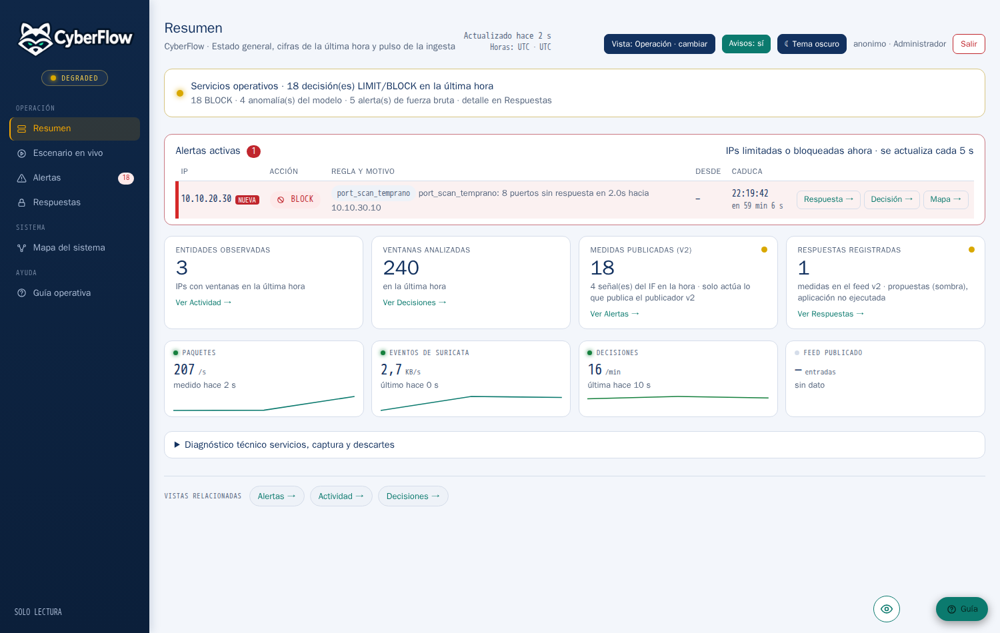

# CyberFlow · demo del panel en Docker

Laboratorio de demostración de **CyberFlow**, el sistema open source de detección
temprana de comportamientos anómalos en redes de datos (tesis UPeU, 2026). Con un
solo comando levanta, **en tu propia PC y sin tocar tu red**, la misma cadena que
corre en el sensor del laboratorio, y el panel web para verla funcionar:

- **tráfico real** entre contenedores: dos clientes legítimos y una Kali que ataca;
- **captura real**: anillo de PCAP con `tcpdump` y `eve.json` de Suricata;
- **el modelo real**: Isolation Forest `if_limpio_2026_10` (α = 0,01, umbral
  −0,6223889502) más los heurísticos deterministas del motor;
- **la respuesta real**: el publicador v2 emite un feed **firmado (ed25519)** con
  PERMIT · LIMIT · BLOCK y caducidad;
- **el panel** con todas sus vistas, incluida *Datos en vivo* (las tramas del PCAP y
  los eventos de Suricata, uno a uno, como Wireshark).

Nada de lo que muestra el panel está pregrabado: cada decisión la calcula el motor
sobre el tráfico que generan los contenedores en ese momento.



## Requisitos

- **Docker** con Compose v2 (Docker Desktop en Windows o macOS, Docker Engine en Linux).
- Unos 3 GB de disco para las imágenes y 2 GB de RAM libres.
- Ninguna dependencia de Python en tu equipo: todo corre en los contenedores.

## Arrancar

**Windows (PowerShell)**

```powershell
git clone <url-de-este-repositorio> cyberflow-demo
cd cyberflow-demo
.\demo.ps1 iniciar
```

> Si PowerShell bloquea el script: `powershell -ExecutionPolicy Bypass -File .\demo.ps1 iniciar`

**Linux / macOS / Git Bash**

```bash
git clone <url-de-este-repositorio> cyberflow-demo
cd cyberflow-demo
./demo.sh iniciar
```

Abre **http://127.0.0.1:8788**. La primera vez tarda unos minutos en construir las
imágenes. El panel solo escucha en `127.0.0.1`: no queda expuesto en tu red.

## Qué vas a ver

Al minuto y medio la Kali empieza sola su recorrido y lo repite indefinidamente,
con 4 minutos entre escenario y escenario para que cada medida caduque:

| Escenario | Qué hace la Kali (10.10.20.30) | Qué debe responder CyberFlow |
|---|---|---|
| `l4` · escaneo de puertos | `nmap -sT` a 3000 puertos del servidor | vía rápida en ~2 s y regla `port_scan` → **BLOCK** |
| `brute` · fuerza bruta HTTP | 120 logins fallidos (401) contra `:8081` | regla `brute_force` → **BLOCK** |
| `l7` · abuso HTTP | 900 peticiones en paralelo | regla `http_abuse` → **LIMIT** |
| `fp` · tráfico legítimo | ping, 2 puertos y 5 páginas | **PERMIT**, sin alerta |

Los clientes `10.10.20.21` y `10.10.20.22` navegan, resuelven nombres y hacen ping
todo el tiempo a ritmo humano: deben quedar siempre en **PERMIT**.

Para lanzar tú los escenarios en lugar del ciclo automático:

```powershell
.\demo.ps1 iniciar -Manual       # ./demo.sh iniciar --manual
.\demo.ps1 ataque l4             # l4 | brute | l7 | l3 | dns | fp | intenso
```

Son los seis escenarios de *Escenario en vivo*:

- `l3` · inundación ICMP: el motor desplegado **no tiene regla ICMP**, así que solo
  puede aparecer como señal del modelo. El panel lo declara igual.
- `dns` · DNS de alta entropía (DGA): 80 nombres aleatorios; regla `dns_entropy` → LIMIT.
  En el laboratorio el resolver es DC1; aquí es el srv-dmz.
- `intenso` · cliente legítimo intenso: `cliente1` pide 60 páginas seguidas y debe
  quedar en PERMIT.

## Otras órdenes

| Orden | Qué hace |
|---|---|
| `estado` | contenedores y últimas decisiones relevantes del motor |
| `registros` | registros en vivo de captura, Suricata, motor, vía rápida y publicador |
| `capturas` | guarda una captura de cada vista del panel en `docs/capturas/` |
| `parar` | apaga y borra los contenedores; no queda nada en tu equipo salvo las imágenes |

## Cómo está montado

```
 cliente1 10.10.20.21 ─┐
 cliente2 10.10.20.22 ─┼──► srv-dmz 10.10.30.10   web 80/443 · login 8081 · DNS 53
 kali     10.10.20.30 ─┘        │
                                └─ sensor (misma interfaz que srv-dmz, como un espejo SPAN)
                                     tcpdump ──► anillo live-*.pcap (5 s)
                                     Suricata ─► eve.json (sin reglas: solo como parser)
                                     motor_decision.py ─► motor_decision.log
                                     detector_rapido.py ─► señales rápidas de escaneo
                                     publicar_feed_v2 ──► feed.json + feed.sig (ed25519)
                                     dashboard.py ─────► http://127.0.0.1:8788
```

La red `10.10.0.0/16` y las IP copian las del laboratorio real, para que los
escenarios del panel muestren los mismos comandos. El segmento `10.10.0.0/24`
(la pasarela por la que entra tu navegador y las herramientas de la demo) se captura
pero no se puntúa, igual que en el sensor se excluye el bastión.

`producto/` es una copia **reducida** del repositorio del sistema
([`main@41f741a`](https://github.com/marksato13/VF-Sistema-Open-Source-para-la-Deteccion-Temprana-de-Comportamientos-Anomalos-en-Redes-de-Datos/tree/41f741a)):
el motor, el extractor, el panel, el publicador v2 del laboratorio, el modelo
congelado y sus manifiestos, **sin modificar**. Solo cambia
`configs/cyberflow.local.toml`, que describe este laboratorio (interfaz `eth0`,
rutas del contenedor, exclusión de la gestión).

## Diferencias con el laboratorio real

Dicho claramente, para no confundir la demo con una medición:

- **Modo sombra.** El feed se publica y se firma, pero ningún agente lo aplica con
  `nftables`: el panel lo muestra como *propuesta (sombra)* y *aplicación no
  ejecutada*, igual que el laboratorio en sombra. Por eso las tarjetas de acuse del
  agente quedan vacías.
- **Sin login ni TLS.** El panel arranca con `--sin-autenticacion` porque solo escucha
  en `127.0.0.1`. En el sensor real exige TLS, usuario y rol.
- **Otro tráfico, mismo modelo.** El modelo se entrenó con tráfico normal del
  laboratorio, no con el de estos contenedores. Que los clientes queden en PERMIT
  aquí es una comprobación de la demo, **no** una métrica de falsos positivos.
- **Servicios.** No hay `systemd`: un `systemctl` mínimo responde *active* solo si el
  proceso equivalente está vivo, así que el verde del panel sigue siendo verdad.
- **Docker reinicia → hueco.** Si apagas y enciendes, el panel avisa de un hueco en
  la traza durante la primera hora. Es correcto: no hubo publicaciones en ese rato.

## Licencia y autoría

Código bajo licencia **MIT** (ver [`LICENSE`](LICENSE)), como el repositorio del
sistema. Autores del sistema: Rubén Mark Salazar Tocas y Uziel Elias Sauñe Fernandez,
Universidad Peruana Unión. Asesores: Ing. Nemias Saboya Ríos e Ing. Fernando Manuel
Asin Gómez.
